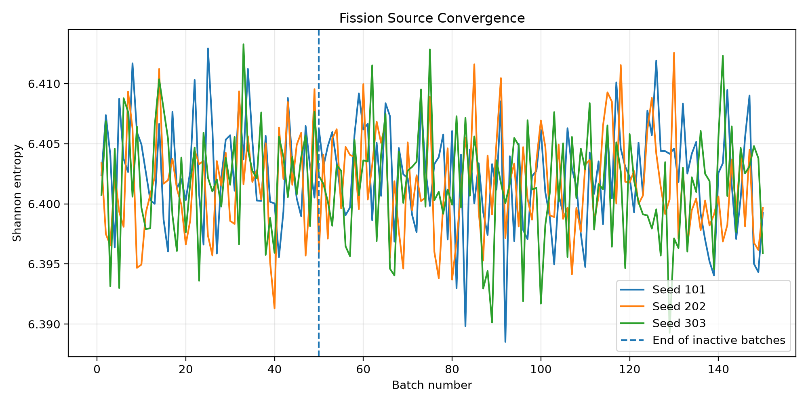
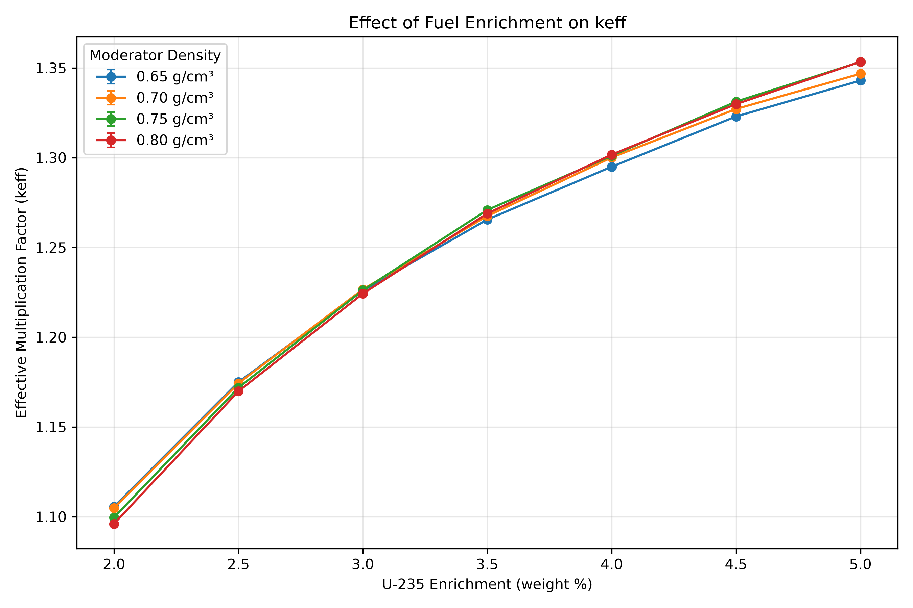
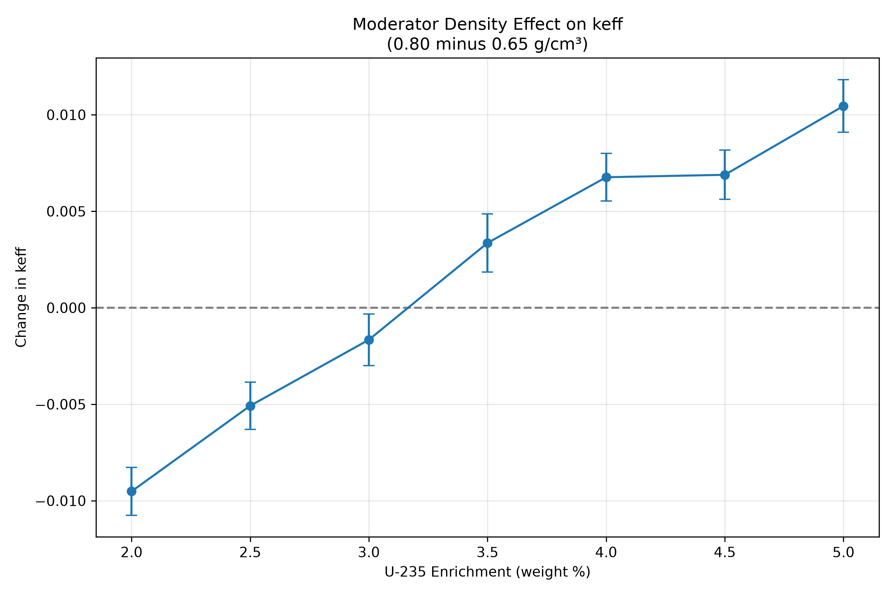
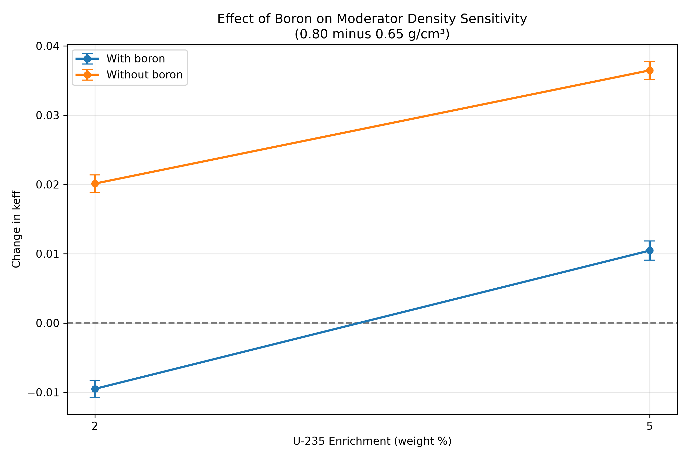
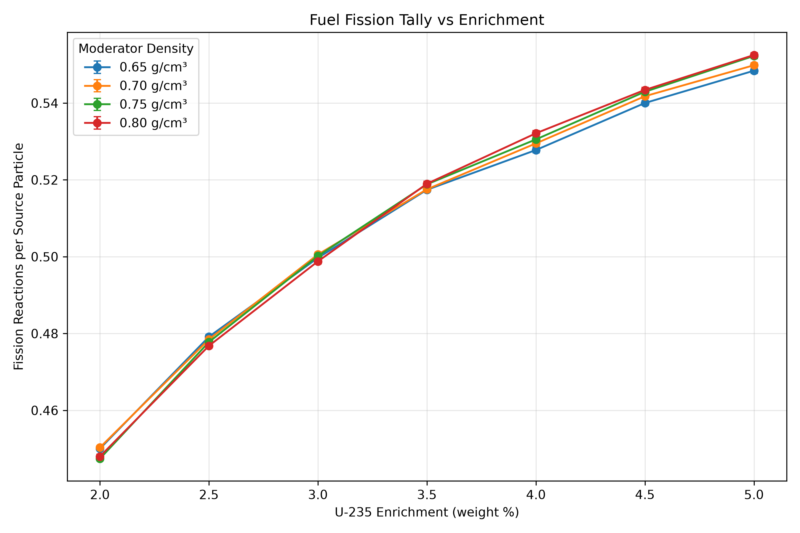

# OpenMC Parametric Neutronics Simulation Study

**Technical report | October 2026**  
**Tools:** OpenMC 0.16.0, Python, NumPy, Pandas, Matplotlib  
**Type:** Educational, reproducible reactor-physics sensitivity study

> **Scope:** This is a simplified PWR fuel pin-cell model used to investigate nuclear simulation workflows and parameter sensitivity. It is not a complete reactor core, a digital twin, a validated design model, or a safety analysis.

## Abstract

A Python-driven OpenMC workflow was developed to examine how uranium-235 enrichment and moderator mass density affect neutron multiplication in a simplified, reflective pressurized-water-reactor (PWR) fuel pin cell. The primary study comprised **28 combinations** of seven enrichments (2.0–5.0 wt% U-235 in uranium) and four moderator densities (0.65–0.80 g/cm³). Each primary case used 150 batches, 50 inactive batches, and 10,000 particles per batch, corresponding to **1,000,000 active neutron histories**. The calculated effective multiplication factors ranged from **1.096075 to 1.353420**, with a maximum reported one-standard-deviation Monte Carlo uncertainty of **0.001151**. The increase in k-effective with enrichment was consistent across moderator densities; the density response changed sign across the tested enrichment range. Four additional unborated control simulations showed that boron absorption substantially influenced the density response. The project additionally produced source-normalized flux/fission tallies, convergence checks, reproducible CSV outputs, and scientific figures. Results are interpreted as model-specific sensitivity estimates, subject to simplified geometry and nuclear-data limitations.

## 1. Objective and motivation

The purpose was to learn a nuclear-specific computational modeling tool while applying computer-science skills to scientific software: defining physical models programmatically, running reproducible simulation campaigns, extracting results, checking statistical behavior, and presenting evidence-based conclusions. A pin cell is a practical first model because it retains meaningful fuel, cladding, moderator, and neutron-transport physics without the complexity of a full reactor core.

## 2. Model and assumptions

The base geometry was adapted from OpenMC's bundled `openmc.examples.pwr_pin_cell()` example, which draws its base parameters from the BEAVRS reference model. The student-defined implementation used concentric cylindrical fuel and cladding regions enclosed by a square lateral reflective boundary, corresponding to an axially infinite, repeating pin-cell approximation.

| Property | Specification |
|---|---|
| Fuel | UO2, density 10.29769 g/cm³; variable uranium-235 enrichment |
| Cladding | Zircaloy, density 6.55 g/cm³ |
| Moderator | Borated water, density 0.65–0.80 g/cm³ |
| Fuel radius | 0.39218 cm |
| Outer cladding radius | 0.45720 cm |
| Square pitch | 1.26 cm |
| Boundary conditions | Reflective on four lateral sides; axially infinite |
| Transport / nuclear data | Continuous-energy k-eigenvalue Monte Carlo / ENDF/B-VIII.1 HDF5 |

Uranium was specified through OpenMC's enrichment-enabled element API (which uses an isotopic enrichment correlation rather than exactly reproducing the reference example's fixed uranium isotope vector). The model did **not** explicitly represent a fuel-cladding gap, finite-length rod, fuel depletion, thermal-hydraulic feedback, or core leakage. The reported nuclear-data temperatures in the run log were 294 K; density was varied without a corresponding coupled moderator-temperature change.

*Figure 1. Material-colored cross-section of the simplified pin cell. Colors are material identifiers rather than flux or temperature. The raw geometry plot is available from the model development folder and may be added to the portfolio if desired.*

## 3. Simulation and data workflow

The Python model-building function accepted enrichment, moderator density, and numerical settings. Separate scripts executed cases in distinct directories, read OpenMC `statepoint` files, and wrote CSV summaries. The analysis pipeline checked that all 28 parameter combinations were present, unique, and populated before plotting.

Each main case used **150 total batches**, **50 inactive** (for fission-source settling), and **10,000 particles per batch**. After excluding inactive batches, the analysis used 100 active batches × 10,000 particles = **1 million active histories per case**. A distinct, recorded random seed was assigned to each main case. Outputs included combined k-effective with Monte Carlo standard uncertainty and three cell-filtered tallies: fuel flux, moderator flux, and fuel fission reactions.

The initial `flux` scores are *volume-integrated, source-normalized track-length tallies* (particle-cm per source particle). The `fission` score measures reactions per source particle. They are not directly absolute fluxes or fission rates per second; no power normalization was applied.

## 4. Verification and numerical precision

**Material construction.** Input-verification checks reproduced requested enrichment values of 2.40% and 3.50% to displayed precision and moderator densities of 0.740582 and 0.650000 g/cm³. The enriched uranium composition included U-234, U-235, U-236, and U-238.

**Implementation reproduction.** An explicit manually constructed fixed-composition model matched OpenMC's reference pin-cell example at k-effective = 1.15881 ± 0.00265 under matching inputs and random sequence. This supports implementation consistency, but not independent experimental validation. The later enrichment-parameterized model differs in uranium isotope specification, and its numerical values should not be expected to match the fixed-composition case exactly.

**Particle-history study.** Three numerical configurations showed lower reported statistical uncertainty as active histories increased:

| Active histories | k-effective | Standard uncertainty |
|---:|---:|---:|
| 90,000 | 1.161306 | 0.003204 |
| 400,000 | 1.160142 | 0.001423 |
| 1,000,000 | 1.159147 | 0.000977 |

These runs used the same seed and were therefore not treated as statistically independent replications. Subsequent independent 1-million-history runs using seeds 101, 202, and 303 yielded **1.161331 ± 0.000897**, **1.159469 ± 0.000937**, and **1.160110 ± 0.000812**, respectively. Their arithmetic mean is approximately **1.160303**. The estimates were statistically compatible. The three fission-source Shannon-entropy curves fluctuated around a stable level before and after the boundary at batch 50, supporting the selected inactive-batch count for the checked baseline; these checks do not prove convergence for every sweep point.

*Figure 2. Shannon entropy versus simulation batch for three seeds. The dashed line marks the end of the 50 inactive batches.*

## 5. Results: primary 28-case study

The full study varied enrichment from 2.0% to 5.0% in 0.5%-point steps and moderator density among 0.65, 0.70, 0.75, and 0.80 g/cm³. The computed k-effective values are summarized below (rounded to 5 decimal places; unrounded values and each uncertainty are in `sweep_runs/sweep_summary.csv`).

| U-235 enrichment | 0.65 g/cm³ | 0.70 g/cm³ | 0.75 g/cm³ | 0.80 g/cm³ |
|---:|---:|---:|---:|---:|
| 2.0% | 1.10559 | 1.10483 | 1.09965 | 1.09607 |
| 2.5% | 1.17495 | 1.17432 | 1.17183 | 1.16987 |
| 3.0% | 1.22590 | 1.22662 | 1.22613 | 1.22424 |
| 3.5% | 1.26550 | 1.26748 | 1.27085 | 1.26886 |
| 4.0% | 1.29492 | 1.30008 | 1.30102 | 1.30168 |
| 4.5% | 1.32293 | 1.32712 | 1.33121 | 1.32982 |
| 5.0% | 1.34296 | 1.34675 | 1.35333 | 1.35342 |

*Figure 3. k-effective increases with U-235 enrichment across the four sampled moderator densities. Bars denote one-standard-deviation reported Monte Carlo sampling uncertainty.*

At every tested density, increasing enrichment increased estimated k-effective. The density effect, however, depended on enrichment. Define the endpoint response as:

\[\Delta k_{\mathrm{eff}} = k_{\mathrm{eff}}(0.80\ \mathrm{g/cm^3}) - k_{\mathrm{eff}}(0.65\ \mathrm{g/cm^3}).\]

| U-235 enrichment | Endpoint Δk-effective ± propagated sampling uncertainty |
|---:|---:|
| 2.0% | −0.009515 ± 0.001236 |
| 2.5% | −0.005080 ± 0.001218 |
| 3.0% | −0.001659 ± 0.001334 |
| 3.5% | +0.003359 ± 0.001511 |
| 4.0% | +0.006763 ± 0.001232 |
| 4.5% | +0.006888 ± 0.001279 |
| 5.0% | +0.010456 ± 0.001364 |

*Figure 4. The moderator-density endpoint response changes from negative at low enrichment to positive at high enrichment. The response around 3.0% is small compared with its sampling uncertainty, so the precise sign-transition enrichment cannot be established from these data alone.*

## 6. Boron control experiment and interpretation

Four additional cases removed B-10 and B-11 from the water material at 2.0% and 5.0% enrichment and the endpoint moderator densities of 0.65 and 0.80 g/cm³. The same total moderator mass density was specified; removing boron necessarily altered the normalized concentrations of the remaining hydrogen and oxygen isotopes slightly.

| Enrichment | Borated density response | Unborated density response |
|---:|---:|---:|
| 2.0% | −0.009515 ± 0.001236 | +0.020118 ± 0.001255 |
| 5.0% | +0.010456 ± 0.001364 | +0.036469 ± 0.001284 |

*Figure 5. With boron present, increasing density also increases the boron absorber atom density. Without boron, the endpoint density response is positive at both sampled enrichment levels.*

The control experiments support a substantial role for boron absorption in the original density response. At 2.0% enrichment, eliminating boron reversed the sign of the endpoint response. At 5.0%, it increased the positive response. These results are consistent with competition between neutron moderation and absorption. They do **not** uniquely isolate every neutron-spectrum, number-density, or composition effect, nor do they establish realistic PWR moderator-temperature coefficients.

The accompanying fuel fission tally also rose overall with enrichment. It is plotted separately as a **source-normalized reaction-rate diagnostic**, not absolute reactor power:

*Figure 6. Fuel fission reactions per source particle across the parametric study.*

## 7. Limitations and quality considerations

1. **Simplified geometry.** The reflective single-pin model neglects real core leakage, control systems, fuel assemblies, finite length, and explicit fuel-cladding gap. It cannot establish a full-core k-effective or real operating margins.
2. **Uncoupled thermal conditions.** Runs reported 294 K nuclear data; density variation was independent of temperature. This is a numerical density/composition sensitivity study, not realistic thermal feedback or transient modeling.
3. **Composition coupling.** With fixed borated-water isotope proportions, changing total density changes H, O, and boron atom densities together. The unborated control holds total density, not every remaining atomic number density, fixed.
4. **Sampling vs model uncertainty.** Reported ± values reflect OpenMC Monte Carlo statistics only. They exclude uncertainty in nuclear data, missing physics, geometric simplifications, and material specifications.
5. **Nuclear-data warning.** Some simulations reported negative entries in the Zr-96 probability table at 294 K. The computations completed, but the significance of this processed-data warning was not quantified; it must be disclosed rather than dismissed.
6. **Verification boundaries.** Baseline source-entropy and independent-seed checks do not demonstrate source convergence at all 28 settings. No external experimental or independent-code benchmark validation was performed.

## 8. Reproducibility and deliverables

The portfolio contains `parametric_model.py`, `run_sweep.py`, `check_boron_effect.py`, `run_convergence.py`, `verify_convergence.py`, input checks and analysis scripts; processed CSV results; figures; `environment.yml`; and a separate README with execution instructions. OpenMC-generated HDF5 statepoints and model XML files were intentionally not bundled. A matching ENDF/B-VIII.1 HDF5 library and valid `OPENMC_CROSS_SECTIONS` environment variable are required to reproduce transport calculations. To regenerate figures from archived CSV files, run `python verify_parameters.py`, `python analyze_sweep.py`, and `python analyze_boron_control.py` from the project root.

**Conclusion.** This student project demonstrates end-to-end scientific Python development around a neutron-transport solver: model construction, controlled parameter sweeps, statistical precision assessment, source-convergence diagnostics, structured data extraction, follow-up hypothesis testing, and transparent communication of limitations. Its results apply to the specified simplified model and should not be extrapolated to an operating reactor.

## References

1. OpenMC Project, *PWR pin-cell example*, `openmc.examples.pwr_pin_cell` (source): https://github.com/openmc-dev/openmc/blob/develop/openmc/examples.py
2. OpenMC Documentation, *Specifying Tallies*: https://docs.openmc.org/en/stable/usersguide/tallies.html
3. OpenMC Documentation, *Simulation Settings / Shannon Entropy*: https://docs.openmc.org/en/stable/usersguide/settings.html
4. OpenMC Project, *Nuclear Data Libraries*: https://openmc.org/data/
5. OpenMC Documentation, *Getting Started / User's Guide*: https://docs.openmc.org/en/stable/usersguide/index.html

**Data provenance:** Numerical results and graphics were provided from the student's recorded local OpenMC runs. This report summarizes those results; it is not a claim of independent benchmark validation.
